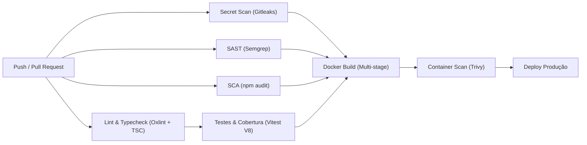

# AUDIT.BARCODE // Sistema de Inventário & Auditoria de Ativos via Leitor HID

Sistema web corporativo completo, moderno, responsivo e pronto para produção para **Controle de Inventário Físico e Auditoria de Ativos/Máquinas** com foco em galpões, fábricas e academias, desenvolvido com **React 19, TypeScript, Tailwind CSS v4, Lucide Icons, SheetJS (XLSX)** e **Supabase (PostgreSQL, Auth e Realtime)**.

---

## 🚀 Destaques e Diferenciais de Engenharia

### 1. Suporte Nativo ao Leitor Nonus LW200 (Modo Teclado HID)
- **Autofocus Persistente Inteligente:** O campo de bipe mantém o foco automaticamente e possui re-foco inteligente ao clicar na tela (sem roubar o foco se o usuário estiver digitando em outros inputs de modal ou formulários).
- **Global HID Keystroke Interceptor:** Se o operador acionar o leitor de código de barras mesmo sem ter clicado na caixa de entrada, a rajada rápida de caracteres do leitor é canalizada automaticamente.
- **Optimistic UI (Latência Zero):** O input é limpo imediatamente ao receber o `Enter` do leitor Nonus LW200, disparando a atualização visual e sonora antes mesmo da resposta da rede, permitindo bipes contínuos e velozes.
- **Síntese de Som Nativa (Web Audio API):**
  - **Bipe de Sucesso:** Tom senoidal harmônico ascendente (1050Hz -> 1400Hz), nítido e não fatigante.
  - **Bipe de Alerta (Não Cadastrado):** Tom duplo pulsante em 450Hz para alertar o estoquista sem travar a contagem.
  - **Bipe de Erro:** Tom grave descendente em dente de serra.
  - Sem arquivos de áudio externos — zero erros de codec ou bloqueios de CORS/rede.
- **Banner HUD em Grande Formato:** Exibe o último SKU bipado, descrição, quantidade acumulada e divergência em tamanho grande para visibilidade à distância no estoque.

### 2. Banco de Dados Robusto (Supabase / PostgreSQL)
- **Função RPC Atômica Anti-Concorrência (`registrar_leitura_inventario`):** Garante atomicidade em nível de banco de dados (`ACID`). Quando dois operadores com dois leitores diferentes bipam a mesma máquina no mesmo segundo, não há condição de corrida (*race condition*): a contagem soma de forma perfeitamente consistente.
- **Tratamento de SKU Não Cadastrado:** Se o SKU bipado não estiver cadastrado no ERP, o sistema soma `+1` na contagem com a tag `[NÃO CADASTRADO]`, emite o som de aviso diferenciado e disponibiliza um botão rápido para cadastrá-lo diretamente na linha ou no HUD.
- **Supabase Realtime:** Sincronização multi-usuário ao vivo nos canais `itens_inventariados` e `logs_leituras`.

### 3. Importação e Exportação Excel / ERP
- **Preservação Estrita de Zeros à Esquerda:** Leituras de códigos alfanuméricos como `002NA01AC`, `010KB88` ou `205N51` são tratadas como strings cruas, prevenindo truncamentos indesejados.
- **Importação CSV / XLSX:** Upload com detecção flexível de colunas (`Código`, `Descrição`, `Estoque`, `Custo`), prévia com amostra dos dados e *upsert* em lote.
- **Download de Modelo Excel:** Arquivo pronto para preenchimento com exemplos reais de maquinários e ativos.
- **Exportação Avançada (.xlsx e .csv):** Gera planilha com aba de itens auditados e aba de Resumo Executivo (Taxa de Acurácia %, Balanço Financeiro R$, Total de Peças Físicas Bipadas, Total de SKUs Divergentes).

---

## 🛠️ Tecnologias Utilizadas

- **Frontend:** React 19, TypeScript, Vite, Tailwind CSS v4, Lucide React
- **Planilhas:** SheetJS (`xlsx`) para manipulação de arquivos Excel e CSV
- **Efeitos Sonoros:** Web Audio API nativo (OscillatorNode + GainNode com envelope ADSR)
- **Feedback Visual:** Canvas Confetti e animações de alto contraste em CSS puro
- **Backend / Database:** Supabase (PostgreSQL 15+, Row Level Security, RPC Functions, Auth, Realtime)

---

## 📦 Estrutura do Projeto

```
inventario/
├── supabase/
│   └── schema.sql                 # Script SQL completo: Tabelas, RLS, RPCs, Índices e Realtime
├── src/
│   ├── components/
│   │   ├── AuditLogDrawer.tsx     # Painel lateral retrátil com histórico de cada bipe
│   │   ├── AuthScreen.tsx         # Tela de autenticação corporativa (Supabase Auth / Demo)
│   │   ├── InventoryTable.tsx     # Tabela de contagem em tempo real com filtros rápidos
│   │   ├── Navbar.tsx             # Topo com status de conexão, mute e atalhos
│   │   ├── ProductCatalogModal.tsx# Gestão da base do ERP e Importador Excel/CSV
│   │   ├── ScannerInput.tsx       # Componente do Leitor Nonus LW200 com HUD e autofocus
│   │   ├── SessionKPIs.tsx        # Cards de indicadores: Total bipado, SKUs, Acurácia %, R$
│   │   ├── SessionsView.tsx       # Gestão de sessões de inventário e finalização
│   │   └── SqlInstructionsModal.tsx# Modal com script SQL e configuração de credenciais
│   ├── contexts/
│   │   └── AuthContext.tsx        # Provedor de autenticação e sessão de usuário
│   ├── lib/
│   │   ├── excel.ts               # Parser e exportador XLSX/CSV com preservação de zeros
│   │   ├── sound.ts               # Síntese sonora profissional com Web Audio API
│   │   └── supabase.ts            # Cliente Supabase e gerenciador de credenciais
│   ├── services/
│   │   └── inventoryService.ts    # Camada de serviços RPC e fallback local/offline
│   ├── types/
│   │   ├── canvas-confetti.d.ts   # Declaração tipada de confetti
│   │   └── inventory.ts           # Modelagem de tipos TypeScript
│   ├── App.tsx                    # Aplicação principal
│   ├── index.css                  # Estilos Tailwind e animações de flash visual
│   └── main.tsx                   # Ponto de entrada
├── .env.example                   # Exemplo das variáveis de ambiente
└── package.json
```

---

## ⚡ Passo a Passo para Configurar o Supabase

### 1. Criar o Projeto no Supabase
1. Acesse [supabase.com](https://supabase.com) e crie uma conta gratuita ou faça login.
2. Crie um novo projeto (ex: `inventario-ativos`).

### 2. Executar o Script SQL
1. No painel do seu projeto no Supabase, abra o menu **SQL Editor** no menu lateral esquerdo.
2. Clique em **New query**.
3. Copie todo o conteúdo do arquivo [supabase/schema.sql](file:///c:/Users/adm/Documents/MEGA/VSCODE/inventario/supabase/schema.sql) e cole no editor.
4. Clique no botão verde **Run** (Executar).
5. O script criará:
   - Tabela `produtos_cadastro` com índices no SKU e descrição;
   - Tabela `sessoes_inventario`;
   - Tabela `itens_inventariados` com constraint `UNIQUE(sessao_id, codigo_sku)`;
   - Tabela `logs_leituras`;
   - Função RPC atômica `registrar_leitura_inventario`;
   - Função RPC `ajustar_quantidade_manual`;
   - Políticas de Row Level Security (RLS);
   - Publicações do canal Supabase Realtime.

### 3. Configurar as Chaves de Acesso
No painel do Supabase, acesse **Project Settings** → **API**. Copie:
- **Project URL**
- **Project API keys: `anon` `public`**

Você pode inseri-las de duas formas:
- **Opção A (Arquivo `.env`):**
  Copie o arquivo `.env.example` para `.env` e preencha:
  ```env
  VITE_SUPABASE_URL=https://seu-projeto.supabase.co
  VITE_SUPABASE_ANON_KEY=sua-anon-public-key-aqui
  ```
- **Opção B (Direto pela Interface Web):**
  Ao abrir o sistema, clique no botão **"Supabase / Modo Local"** no topo da tela e cole as duas chaves. O sistema salva e conecta automaticamente sem precisar reiniciar o servidor!

---

## 💻 Como Rodar o Projeto Localmente

1. **Instalar dependências (já executado):**
   ```bash
   npm install
   ```

2. **Iniciar o servidor de desenvolvimento:**
   ```bash
   npm run dev
   ```

3. **Compilar para produção:**
   ```bash
   npm run build
   ```

4. **Pré-visualizar a versão de produção:**
   ```bash
   npm run preview
   ```

---

## 🛡️ DevSecOps & Pipeline CI/CD

O projeto conta com uma esteira automatizada completa de **DevSecOps** e **CI/CD** estruturada sob o arquivo [.github/workflows/ci-cd.yml](file:///c:/Users/adm/Documents/MEGA/VSCODE/inventario/.github/workflows/ci-cd.yml), projetada para garantir zero segredos em código, alta qualidade de software, ausência de vulnerabilidades de segurança e empacotamento seguro para produção:



### 1. Detecção Contínua de Segredos (Gitleaks)
- Scanner de segredos rodando via GitHub Action e configurado por [.gitleaks.toml](file:///c:/Users/adm/Documents/MEGA/VSCODE/inventario/.gitleaks.toml).
- Detecta e bloqueia commits com chaves privadas (`service_role`, JWTs, tokens de API ou credenciais de banco).

### 2. Análise Estática de Segurança (SAST com Semgrep)
- Motor Semgrep configurado com regras OWASP Top 10, TypeScript e React, além de regras personalizadas em [.semgrep.yml](file:///c:/Users/adm/Documents/MEGA/VSCODE/inventario/.semgrep.yml):
  - Prevenção contra injeção de HTML/XSS via `dangerouslySetInnerHTML`.
  - Bloqueio de senhas e segredos hardcoded.
  - Mitigação de Open Redirects em rotas.

### 3. Análise de Composição de Software (SCA)
- Auditoria de dependências com verificação de vulnerabilidades conhecidas (CVEs):
  ```bash
  npm run security:audit
  ```

### 4. Suíte de Testes Automatizados (Vitest + Testing Library)
A aplicação conta com **20 testes automatizados** (100% de aprovação) cobrindo componentes, regras de negócio e integração:
- **`src/test/sound.test.ts` (6 testes):** Validação da síntese sonora de hardware do leitor Nonus LW200 (sucesso ascendente, aviso duplo de SKU não cadastrado, erro e mute).
- **`src/test/excel.test.ts` (3 testes):** Preservação rigorosa de zeros à esquerda em SKUs (`002NA01AC`), autogeração de códigos para produtos sem SKU (`AUTO_0001`) e exportação com aba de Resumo Executivo.
- **`src/test/SessionKPIs.test.tsx` (2 testes):** Validação dos cartões de métricas em tempo real, cálculo de acurácia percentual e balanço financeiro de divergência.
- **`src/test/ScannerInput.test.tsx` (3 testes):** Simulação de leitor Nonus LW200 HID disparando evento `Enter`, limpeza instantânea (*Optimistic UI*), ativação do HUD gigante e cadastro rápido.
- **`src/test/inventoryService.test.ts` (6 testes):** CRUD de produtos, deduplicação em memória antes do envio, ciclo de vida completo de sessões (criar, renomear, finalizar, reabrir e excluir) e bipe atômico anti-concorrência.

**Comandos para executar os testes:**
```bash
# Executar todos os testes uma vez
npm test

# Modo observador (Watch Mode)
npm run test:watch

# Gerar relatório completo de cobertura de código (V8 Engine)
npm run test:coverage
```

### 5. Containerização Segura (Hardened Docker Multi-Stage)
O container de produção foi projetado seguindo as melhores práticas de **Hardening**:
- **Multi-Stage Build:** Separa o ambiente de compilação (Node.js 22 Alpine) da imagem final de execução.
- **Nginx Unprivileged (`nginxinc/nginx-unprivileged:alpine`):** Roda sem privilégios de `root` sob o UID 101.
- **Porta não privilegiada:** Escuta na porta `8080`.
- **Cabeçalhos de Segurança Reforçados:**
  - `X-Frame-Options: DENY` (anti-clickjacking)
  - `X-Content-Type-Options: nosniff` (anti-MIME sniffing)
  - `Permissions-Policy: camera=(), microphone=(), geolocation=()`
  - `Content-Security-Policy (CSP)` restrita ao domínio do Supabase e assets locais
  - `Server Tokens desativados` (`server_tokens off;`)
- **Healthcheck Nativo:** Endpoint `/healthz` configurado para sondagem em orquestradores (Kubernetes/Docker Swarm/Cloud Run).
- **Container Vulnerability Scan (Trivy):** Escaneamento automático de vulnerabilidades do SO e pacotes Alpine durante o pipeline.

**Como construir e rodar o container Docker:**
```bash
# 1. Construir a imagem com build args (opcional)
docker build -t inventario-industrial:latest .

# 2. Executar o container sem privilégios de root
docker run -d -p 8080:8080 --name inventario-app inventario-industrial:latest

# 3. Testar a rota de healthcheck
curl http://localhost:8080/healthz

# 4. Acessar a aplicação no navegador
http://localhost:8080
```

---

## 🏷️ Testando com o Leitor de Código de Barras Nonus LW200

1. Conecte o leitor **Nonus LW200** via cabo USB ou dongle sem fio no computador. Ele será reconhecido como dispositivo HID padrão (modo teclado).
2. Abra a aplicação no navegador na aba **Contagem (Bipe)**.
3. O campo principal já estará com **foco automático ativado**.
4. Aponte o leitor para o código de barras da máquina ou digite um SKU de teste (ex: `205N51`, `002NA01AC`, `010KB88`) e pressione `Enter`:
   - Se cadastrado: o sistema tocará o **bipe suave agudo**, emitirá um **flash verde**, incrementará a contagem instantaneamente e exibirá os dados no HUD.
   - Se não cadastrado: tocará o **alerta duplo**, emitirá um **flash âmbar** e exibirá o botão **Cadastrar Este SKU Agora**.
5. Abra a mesma tela em outra janela ou dispositivo: ao bipar em um, o número atualiza em tempo real no outro via Supabase Realtime!
